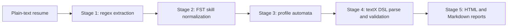

# ResumeLens — Formal resume screening

Universidad Icesi\
Curso: Estructuras Discretas III (CyED III, Código 09772)\
Proyecto Integrador: ResumeLens\
Equipo: Nicolás Santiago Buelvas González, Daniel Alexander Nastul Flórez, Albert Valencia Escobar\
Profesor: Andrés Aristizábal (Grupo 3)

**Authors and contributions**

- **Nicolás Buelvas:** Stages 1–2, extraction and skill normalization.
- **Daniel Nastul:** Stages 3–4, profile recognition and DSL.
- **Albert Valencia:** visualization, validation work, and literature review.

ResumeLens is a Python project for extracting resume data, normalizing skills, recognizing four profiles, and creating reports.

Python version: 3.10+

## Contents

- [Overview](#overview)
- [Features](#features)
- [Project structure](#project-structure)
- [Requirements and installation](#requirements-and-installation)
- [Quick start](#quick-start)
- [Command-line options](#command-line-options)
- [Tests](#tests)
- [Formal and research documents](#formal-and-research-documents)
- [Synthetic dataset](#synthetic-dataset)
- [Known limitations](#known-limitations)
- [Authors and contributions](#authors-and-contributions)
- [Academic use](#academic-use)

## Overview

ResumeLens is a project that analyzes plain-text resumes with regular expressions, finite-state transducers, deterministic finite automata, a textX DSL, and HTML or Markdown reports.



The pipeline handles four configured profile types: Full Stack Developer, Machine Learning Engineer, Backend Developer, and Data Engineer. A profile marked `ACCEPTED` means its current automaton accepted the normalized skill sequence; it does not prove a candidate’s ability or job fit.

## Features

- Extract contact details and supported skill mentions from UTF-8 plain-text resumes.
- Normalize configured spelling variants to canonical skill tokens.
- Evaluate canonical tokens with four profile automata.
- Parse, validate, and serialize a structured resume DSL model.
- Generate HTML and Markdown reports, or print DSL and a console summary.
- Run a batch demo on the six fictional resumes in `data/resumes/`.

## Project structure

Repository tree, shown to depth three:

```text
.
├── data/                         — synthetic input data
│   └── resumes/                  — six fictional plain-text resumes
├── docs/                         — formal specifications, research, and guides
│   ├── execution_guide.md        — installation, CLI, tests, troubleshooting
│   ├── architecture_and_tests.md — module design and test scenarios
│   ├── formal_automata.md        — profile automata specifications
│   ├── formal_transducers.md     — extraction and FST specifications
│   ├── dsl_specification.md      — textX grammar and validation rules
│   ├── literature_review.md      — formal methods and resume screening
│   ├── research_poster.md        — pre-existing research poster draft
│   └── ResumeLens editable.pdf   — poster (PDF export)
├── src/                          — application source code
│   ├── config/                   — profile taxonomy and skill alphabets
│   ├── dsl/                      — textX grammar, parser, validator, serializer
│   │   └── grammar/              — resume DSL grammar
│   ├── extraction/               — contact and skill extraction
│   ├── models/                   — profile and domain models
│   ├── normalization/             — skill transducers and normalization pipeline
│   ├── recognition/               — profile automata
│   ├── visualization/             — HTML and Markdown renderers
│   │   └── templates/            — HTML and CSS templates
│   ├── main.py                   — command-line entry point
│   └── pipeline.py               — processing and report orchestration
├── tests/                        — unit, pipeline, and dataset integration tests
├── pyproject.toml                — package metadata and dependencies
├── requirements.txt              — pip dependency list
└── README.md                     — project overview and quick start
```

The CLI is implemented in `src/main.py`; this checkout does not contain `src/cli.py`.

## Requirements and installation

The project declares Python **3.10 or newer**. Runtime dependencies are `pyformlang>=1.0.10`, `textx>=3.1.0`, and `jinja2>=3.1.0`; the `dev` extra adds `pytest>=7.4.0`. No `LICENSE` file is present, so this README does not claim a software license.

From the repository root, create and activate a virtual environment, then install the project and test dependency:

**Windows PowerShell**

```powershell
py -3.10 -m venv .venv
.\.venv\Scripts\Activate.ps1
python -m pip install --upgrade pip
python -m pip install -e ".[dev]"
```

**macOS or Linux**

```bash
python3 -m venv .venv
source .venv/bin/activate
python -m pip install --upgrade pip
python -m pip install -e ".[dev]"
```

Platform setup note: these are standard venv and pip steps. The CLI and the test suite were verified on Windows using the repository’s existing Python 3.13.0 virtual environment (`.venv`). A from-scratch install with the exact `py -3.10` command, and macOS and Linux setup, were not re-run.

## Quick start

Run commands from the repository root with the virtual environment active. This example was run on `data/resumes/fullstack_valid.txt`:

```bash
python -m src.main data/resumes/fullstack_valid.txt --format summary
```

Observed output excerpt:

```text
CANDIDATE: Lina Marquez
TITLE:     Full Stack Engineer
EMAIL:     lina.marquez@example.com
RAW SKILLS EXTRACTED (9):
NORMALIZED CANONICAL SKILLS (5):
  POSTGRESQL, REACT, GIT, JAVASCRIPT, NODE_JS
PROFILE EVALUATIONS (FINITE AUTOMATA):
  Full Stack Developer           [ACCEPTED]
  Machine Learning Engineer      [REJECTED]
  Backend Developer              [ACCEPTED]
  Data Engineer                  [REJECTED]
```

This observed output shows that a resume can be accepted by more than its intended profile. See the dataset table below; the automata results reflect the current code.

## Command-line options

The actual entry point is `python -m src.main`. Its supported formats are `summary` (default), `dsl`, `html`, `markdown`, and `all`. It also supports `--demo`, `--output`/`-o`, and `--format`/`-f`.

```bash
# Print the summary (the default format)
python -m src.main data/resumes/backend_sample.txt --format summary

# Print the serialized DSL
python -m src.main data/resumes/fullstack_valid.txt --format dsl

# Write an HTML report or Markdown summary
python -m src.main data/resumes/fullstack_valid.txt --format html --output output/fullstack.html
python -m src.main data/resumes/fullstack_valid.txt --format markdown --output output/fullstack.md

# Print the summary and write HTML, Markdown, and DSL files
python -m src.main data/resumes/backend_sample.txt --format all --output output/backend

# Process every .txt file in the bundled dataset
python -m src.main --demo
```

The HTML and Markdown renderers create parent directories for their output files. In `all` mode, the `--output` value is a filename prefix: `output/backend` produces `backend_report.html`, `backend_summary.md`, and `backend.dsl` in that directory. Without `--output`, those files are written beside the input resume. In `dsl` mode, `--output` is the exact DSL filename; its parent directory must already exist. In `summary` mode, `--output` writes DSL text rather than a second summary report.

## Tests

Run the complete test suite with:

```bash
python -m pytest -q
```

On this checkout, `pytest --collect-only -q` collected **100 tests**, and the full suite passed **100 tests**. By file: 37 end-to-end, 16 visualization (10 HTML + 6 Markdown), 15 extraction, 10 normalization, 9 recognition, 5 taxonomy, 4 pipeline, 3 DSL, and 1 environment test. To run tests by area:

```bash
python -m pytest -q tests/test_extraction.py
python -m pytest -q tests/test_normalization.py
python -m pytest -q tests/test_recognition.py tests/test_taxonomy.py
python -m pytest -q tests/test_dsl.py tests/test_pipeline.py tests/test_e2e_resumes.py
python -m pytest -q tests/test_visualization_html.py tests/test_visualization_md.py
python -m pytest -q tests/test_environment.py
```

## Formal and research documents

| Document | Contents |
|:---|:---|
| [Formal transducers](docs/formal_transducers.md) | Regex extraction and FST normalization specifications. |
| [Formal automata](docs/formal_automata.md) | State sets, transitions, and profile recognition results. |
| [DSL specification](docs/dsl_specification.md) | textX grammar, EBNF transcription, and semantic validation. |
| [Literature review](docs/literature_review.md) | Resume screening approaches and formal-method context. |
| [Execution guide](docs/execution_guide.md) | Installation, CLI modes, tests, and troubleshooting. |
| [Architecture and tests](docs/architecture_and_tests.md) | Module design and test scenarios. |

## Synthetic dataset

All six `.txt` files in `data/resumes/` are fictional. The demo produced the following accepted profiles on this checkout:

| Resume file | Accepted profile(s) observed |
|:---|:---|
| `fullstack_valid.txt` | Full Stack Developer; Backend Developer |
| `fullstack_invalid.txt` | Backend Developer |
| `backend_sample.txt` | Backend Developer |
| `ml_engineer_valid.txt` | Machine Learning Engineer; Backend Developer |
| `ml_engineer_invalid.txt` | Backend Developer; Data Engineer |
| `data_engineer_sample.txt` | Data Engineer |

These are the CLI’s observed results, not exclusive target labels. The end-to-end tests check each case’s intended target acceptance or rejection, but do not require every non-target profile to be rejected.

Why `ml_engineer_invalid.txt` is rejected as Machine Learning Engineer: it lists scikit-learn, PyTorch, and TensorFlow, but no data-preparation skill (`PANDAS` or `NUMPY`), so the ML automaton has no transition from the language state to the framework state.

## Known limitations

These behaviors were found by comparing the code, the CLI output, and the documents; they describe the current implementation and are not documented as intended features:

- **Case sensitivity between Stage 1 and Stage 2.** The extraction regexes are mostly case-insensitive, but the transducers only map the exact spellings listed in `src/normalization/skill_transducers.py`. Forms such as `PYTHON`, `REACT`, `Node JS`, `Big Query`, `Scikit-Learn`, and `RESTful APIs` are extracted but then silently dropped during normalization.
- **`REST_APIS` is not accepted by any automaton.** The transducers emit the canonical token `REST_APIS`, but the Full Stack and Backend automata only have transitions for `REST` and `API`. A resume that mentions REST therefore makes those two profiles reject, because the symbol has no transition.
- **Taxonomy and automata alphabets differ.** `SCALA` is in the Backend alphabet but not in the Backend automaton; `REDIS` is missing from the ML and Data Engineer automata; `MONGODB` is missing from the Data Engineer automaton. A sequence containing such a token is rejected.
- **A resume with no recognized skills crashes the DSL stage.** The grammar requires at least one skill, so the pipeline raises a `TextXSyntaxError` instead of a friendly message.
- **Quotes in text fields.** `DSLSerializer` does not escape embedded quotes, so a title such as `Senior "Rockstar" Developer` produces `dsl_text` that cannot be parsed again.
- **Empty experience and education.** The DSL generated by the pipeline always has empty `EXPERIENCE:` and `EDUCATION:` sections.
- **Report language.** The HTML and Markdown reports are rendered in Spanish; the documentation and CLI are in English.

## Academic use

ResumeLens was developed as a project for Discrete Structures III (CyED III), course 09772, at Universidad Icesi. Its dataset is synthetic, and its rules are educational examples. Do not use its classifications as employment decisions or as evidence of a candidate’s real qualifications.
