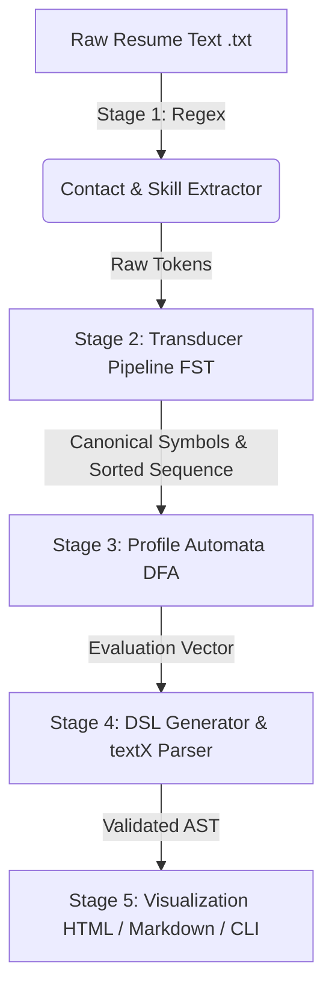

# Architecture Design and Test Suite Specifications

Universidad Icesi  
Curso: Estructuras Discretas III (CyED III, Código 09772)  
Proyecto Integrador: ResumeLens  
Equipo: Nicolás Santiago Buelvas González, Daniel Alexander Nastul Flórez, Albert Valencia Escobar  
Profesor: Andrés Aristizábal (Grupo 3)

---

## 1. System Modular Architecture

ResumeLens is structured as a decoupled, multi-stage processing pipeline where each component operates on well-defined mathematical abstractions.

---

## 2. Module Specifications (Contracts and Signatures)

### 2.1 Information Extraction Module (`src.extraction`)
- **`ContactExtractor.extract(text: str) -> ContactInfo`**
  - Input: Raw plain-text string of a candidate curriculum.
  - Output: Immutable `ContactInfo` dataclass containing `name`, `email`, `phone`, `linkedin`, `github`, `portfolio`, `years_of_experience`, `experience_summary`.
- **`SkillExtractor.extract_unique_skills(text: str) -> List[str]`**
  - Input: Raw resume text.
  - Output: Deduplicated list of surface qualification strings identified across boundary patterns.

### 2.2 Normalization Module (`src.normalization`)
- **`TransducerBuilder.translate_word(word: str) -> Optional[str]`**
  - Input: Raw variation token $w \in \Sigma^*$.
  - Output: Canonical string $K \in \Gamma^*$ emitted upon reaching final state, or `None`.
- **`NormalizationPipeline.process_raw_skills(raw_skills: Iterable[str], profile_type: Optional[ProfileType]) -> List[str]`**
  - Input: Raw qualification tokens.
  - Output: Transduced canonical tokens, deterministically sorted by profile category priority if `profile_type` is provided.

### 2.3 Recognition Module (`src.recognition`)
- **`SoftwareAutomata.fullstack_dfa.accepts(symbols: List[Symbol]) -> bool`**
  - Input: List of canonical symbols ordered by frontend $\to$ backend $\to$ database $\to$ version control.
  - Output: Boolean acceptance.
- **`SoftwareAutomata.backend_dfa.accepts(symbols: List[Symbol]) -> bool`**
  - Input: Candidate qualification symbol list for backend roles.
  - Output: Boolean acceptance.
- **`DataAutomata.ml_dfa.accepts(symbols: List[Symbol]) -> bool`**
  - Input: Canonical symbol sequence for ML roles.
  - Output: Boolean acceptance.
- **`DataAutomata.data_dfa.accepts(symbols: List[Symbol]) -> bool`**
  - Input: Canonical symbol sequence for Data Engineering roles.
  - Output: Boolean acceptance.

### 2.4 DSL and AST Module (`src.dsl`)
- **`DSLParser.parse_string(dsl_code: str) -> object`**
  - Input: DSL textual specification.
  - Output: textX Abstract Syntax Tree.
- **`validate_resume_model(model: object) -> bool`**
  - Input: Parsed AST model.
  - Output: `True` if semantic constraints pass; raises `DSLValidationError` otherwise.
- **`DSLSerializer.serialize_to_dsl(model: object) -> str`**
  - Input: Validated AST model.
  - Output: Canonical DSL code.

### 2.5 Pipeline Orchestrator and Visualization (`src.pipeline`, `src.visualization`)
- **`ResumeLensPipeline.process_file(file_path: Path | str) -> ResumeAnalysisResult`**
  - Integrates all 5 stages end-to-end, returning immutable `ResumeAnalysisResult`.
- **`render_html(model: object) -> str`** / **`render_markdown(model: object) -> str`**
  - Generates final user-facing audit reports.

---

## 3. Test Suite Design and Scenario Matrix

The current test suite contains 100 collected tests, and all 100 pass, as reported by `pytest -q` on this checkout. Test counts can change as tests are added or removed. The count per file is: `test_e2e_resumes.py` 37, `test_visualization_html.py` 10, `test_visualization_md.py` 6, `test_extraction.py` 15, `test_normalization.py` 10, `test_recognition.py` 9, `test_taxonomy.py` 5, `test_pipeline.py` 4, `test_dsl.py` 3, and `test_environment.py` 1.

### 3.1 Unit and Component Testing

| Test File | Target Module | Scope & Invariants Verified |
|:---|:---|:---|
| `test_extraction.py` | `src.extraction` | Boundary regexes for email, phone, social links, skill surface synonyms. |
| `test_normalization.py` | `src.normalization` | FST 7-tuple state transitions, word emissions, deterministic category sorting. |
| `test_recognition.py` | `src.recognition` | DFA acceptance of valid sequences and strict rejection of out-of-order/incomplete sequences. Includes three parametrized accepted and three parametrized rejected sequences for the ML automaton (e.g. `PYTHON, PANDAS` is rejected as incomplete; `PANDAS, PYTHON, ...` and `PYTHON, TENSORFLOW, PANDAS, ...` are rejected as out of order). The Full Stack, Backend, and Data Engineer automata each have one canonical-order test. |
| `test_taxonomy.py` | `src.config` | Canonical alphabet disjointness and profile order consistency. |
| `test_dsl.py` | `src.dsl` | textX parsing, AST serialization, lexical/syntactic failure, semantic email check. |
| `test_visualization_html.py`| `src.visualization` | Jinja2 template rendering, HTML escaping, and CSS injection. |
| `test_visualization_md.py` | `src.visualization` | Markdown punctuation escaping, summary generation, profile tables. |
| `test_pipeline.py` | `src.pipeline` | Centralized orchestrator execution, file I/O, error handling. |

### 3.2 End-to-End Resume Scenarios (`tests/test_e2e_resumes.py`)

A synthetic dataset in `data/resumes/` exercises real-world document variations:

| Scenario / File | Candidate | Target Profile | Expected Classification | Rationale |
|:---|:---|:---|:---:|:---|
| `fullstack_valid.txt` | Lina Marquez | Full Stack Developer | **ACCEPTED** | Has JS, React, Node, Postgres, Git in proper hierarchical progression. |
| `fullstack_invalid.txt` | Mateo Rios | Full Stack Developer | **REJECTED** | Missing required client-side foundational language (`JS`/`TS`). |
| `ml_engineer_valid.txt` | Celeste Arboleda | Machine Learning Engineer | **ACCEPTED** | Has Python, Pandas, TensorFlow, SQL, Git satisfying ML sequence. |
| `ml_engineer_invalid.txt` | Dario Pineda | Machine Learning Engineer | **REJECTED** | Has scikit-learn, PyTorch, and TensorFlow but no data-preparation layer (`PANDAS`/`NUMPY`), so the ML automaton has no transition from `PYTHON` to a framework. |
| `backend_sample.txt` | Sara Beltran | Backend Developer | **ACCEPTED** | Has Python, PostgreSQL, Git meeting server-side requirements. |
| `data_engineer_sample.txt` | Rafaela Quintero | Data Engineer | **ACCEPTED** | Has Python, Apache Spark, SQL satisfying distributed data requirements. |

These expectations cover the intended target profile for each resume; they do not assert that all other profiles reject it. On the current checkout, the CLI also accepts some resumes under non-target profiles: `fullstack_valid.txt` is accepted as Backend Developer, `ml_engineer_valid.txt` as Backend Developer, and `ml_engineer_invalid.txt` as Backend Developer and Data Engineer. This overlap is an observed classifier behavior, not evidence of exclusive profile classification.
