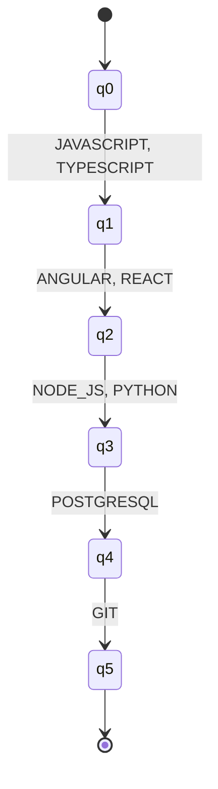
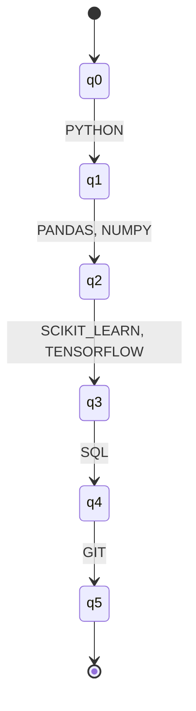
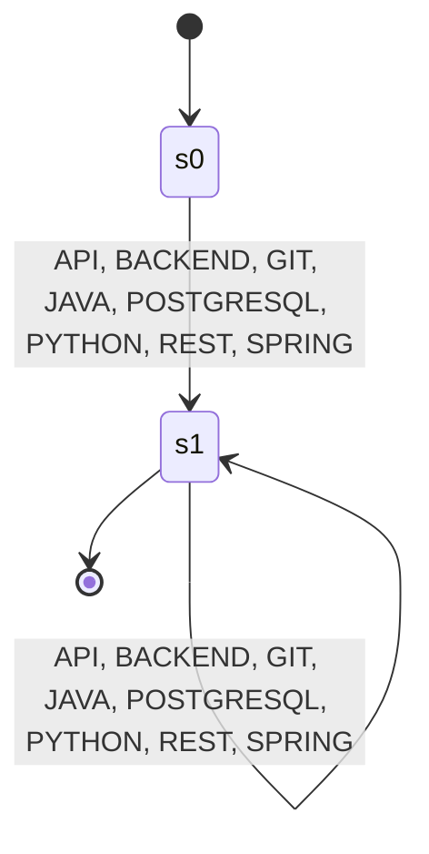
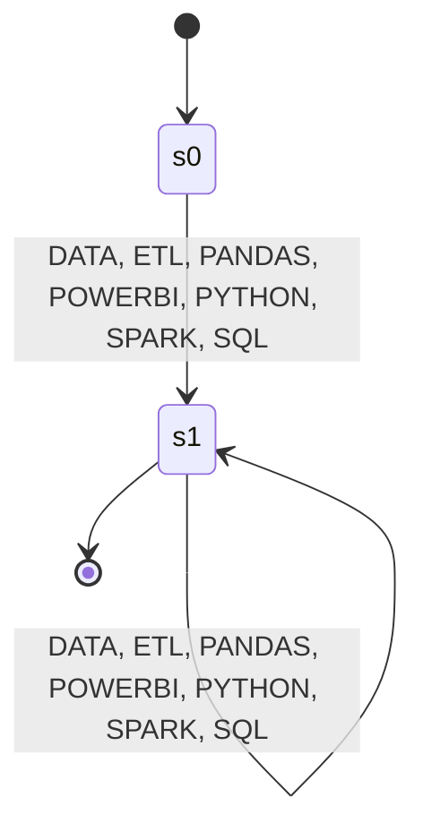

# Formal Specifications: Resume Profile Automata

Universidad Icesi  
Course: Discrete Structures III (CyED III)  
Integrative Project: ResumeLens

---

## 1. Formal Model and Conventions

Each profile recognizer is documented as a five-tuple:

$$M = (Q, \Sigma, \delta, q_0, F)$$

Here, $Q$ is the finite state set, $\Sigma$ is the set of symbols exposed by the automaton, $q_0$ is the initial state, and $F$ is the set of accepting states. Each row in a transition table gives one defined mapping $\delta(q, a) = q'$. The implementation stores only defined transitions, so $\delta$ is partial: an absent transition rejects the input. No implicit sink state is added to the documented state sets. An input is accepted exactly when all its symbols follow defined transitions and the final state belongs to $F$.

The state sets, alphabets, transition rows, initial and final states, determinism results, and traces below were extracted by instantiating the repository's four automata and executing them with pyformlang. The transition tables list every defined transition. `No epsilon transitions` means the extracted transition table contains no epsilon-labelled edge.

---

## 2. Full Stack Automaton

$$M_{FS} = (Q_{FS}, \Sigma_{FS}, \delta_{FS}, q_{0,FS}, F_{FS})$$

- $Q_{FS} = \{q0, q1, q2, q3, q4, q5\}$
- $\Sigma_{FS} = \{ANGULAR, GIT, JAVASCRIPT, NODE\_JS, POSTGRESQL, PYTHON, REACT, TYPESCRIPT\}$
- $q_{0,FS} = q0$
- $F_{FS} = \{q5\}$
- **Classification:** DFA. `is_deterministic()` returned `True`; there are no epsilon transitions.

### Transition Function

| Source State | Input Symbol | Target State |
|:---|:---:|:---|
| q0 | JAVASCRIPT | q1 |
| q0 | TYPESCRIPT | q1 |
| q1 | ANGULAR | q2 |
| q1 | REACT | q2 |
| q2 | NODE_JS | q3 |
| q2 | PYTHON | q3 |
| q3 | POSTGRESQL | q4 |
| q4 | GIT | q5 |

### Accepted Language

The automaton accepts exactly five-symbol sequences of the form
$(JAVASCRIPT \mid TYPESCRIPT)(ANGULAR \mid REACT)(NODE\_JS \mid PYTHON)POSTGRESQL\,GIT$.
Other symbols or ordering leave a transition undefined and are rejected.

### State Diagram

### Executed Traces

| Input sequence | State trace | Result |
|:---|:---|:---:|
| JAVASCRIPT, ANGULAR, NODE_JS, POSTGRESQL, GIT | q0 → q1 → q2 → q3 → q4 → q5 | Accepted |
| JAVASCRIPT, ANGULAR, PYTHON, POSTGRESQL, GIT | q0 → q1 → q2 → q3 → q4 → q5 | Accepted |
| ANGULAR | q0 → undefined transition | Rejected |

---

## 3. Machine Learning Engineer Automaton

$$M_{ML} = (Q_{ML}, \Sigma_{ML}, \delta_{ML}, q_{0,ML}, F_{ML})$$

- $Q_{ML} = \{q0, q1, q2, q3, q4, q5\}$
- $\Sigma_{ML} = \{GIT, NUMPY, PANDAS, PYTHON, SCIKIT\_LEARN, SQL, TENSORFLOW\}$
- $q_{0,ML} = q0$
- $F_{ML} = \{q5\}$
- **Classification:** DFA. `is_deterministic()` returned `True`; there are no epsilon transitions.

### Transition Function

| Source State | Input Symbol | Target State |
|:---|:---:|:---|
| q0 | PYTHON | q1 |
| q1 | NUMPY | q2 |
| q1 | PANDAS | q2 |
| q2 | SCIKIT_LEARN | q3 |
| q2 | TENSORFLOW | q3 |
| q3 | SQL | q4 |
| q4 | GIT | q5 |

### Accepted Language

The automaton accepts exactly five-symbol sequences of the form
$PYTHON(PANDAS \mid NUMPY)(SCIKIT\_LEARN \mid TENSORFLOW)SQL\,GIT$.
In particular, `PYTORCH` is not in this automaton's alphabet.

### State Diagram

### Executed Traces

| Input sequence | State trace | Result |
|:---|:---|:---:|
| PYTHON, NUMPY, SCIKIT_LEARN, SQL, GIT | q0 → q1 → q2 → q3 → q4 → q5 | Accepted |
| PYTHON, NUMPY, TENSORFLOW, SQL, GIT | q0 → q1 → q2 → q3 → q4 → q5 | Accepted |
| GIT | q0 → undefined transition | Rejected |

---

## 4. Backend Automaton

$$M_{BE} = (Q_{BE}, \Sigma_{BE}, \delta_{BE}, q_{0,BE}, F_{BE})$$

- $Q_{BE} = \{s0, s1\}$
- $\Sigma_{BE} = \{API, BACKEND, GIT, JAVA, POSTGRESQL, PYTHON, REST, SPRING\}$
- $q_{0,BE} = s0$
- $F_{BE} = \{s1\}$
- **Classification:** DFA. `is_deterministic()` returned `True`; there are no epsilon transitions.

### Transition Function

| Source State | Input Symbol | Target State |
|:---|:---:|:---|
| s0 | API | s1 |
| s0 | BACKEND | s1 |
| s0 | GIT | s1 |
| s0 | JAVA | s1 |
| s0 | POSTGRESQL | s1 |
| s0 | PYTHON | s1 |
| s0 | REST | s1 |
| s0 | SPRING | s1 |
| s1 | API | s1 |
| s1 | BACKEND | s1 |
| s1 | GIT | s1 |
| s1 | JAVA | s1 |
| s1 | POSTGRESQL | s1 |
| s1 | PYTHON | s1 |
| s1 | REST | s1 |
| s1 | SPRING | s1 |

### Accepted Language

The automaton accepts every non-empty sequence over $\Sigma_{BE}$, or
$\Sigma_{BE}^{+}$. It rejects the empty sequence and any sequence containing a symbol outside $\Sigma_{BE}$.

### State Diagram

### Executed Traces

| Input sequence | State trace | Result |
|:---|:---|:---:|
| API | s0 → s1 | Accepted |
| BACKEND | s0 → s1 | Accepted |
| Empty sequence ($\varepsilon$) | s0 | Rejected |

---

## 5. Data Engineer Automaton

$$M_{DE} = (Q_{DE}, \Sigma_{DE}, \delta_{DE}, q_{0,DE}, F_{DE})$$

- $Q_{DE} = \{s0, s1\}$
- $\Sigma_{DE} = \{DATA, ETL, PANDAS, POWERBI, PYTHON, SPARK, SQL\}$
- $q_{0,DE} = s0$
- $F_{DE} = \{s1\}$
- **Classification:** DFA. `is_deterministic()` returned `True`; there are no epsilon transitions.

### Transition Function

| Source State | Input Symbol | Target State |
|:---|:---:|:---|
| s0 | DATA | s1 |
| s0 | ETL | s1 |
| s0 | PANDAS | s1 |
| s0 | POWERBI | s1 |
| s0 | PYTHON | s1 |
| s0 | SPARK | s1 |
| s0 | SQL | s1 |
| s1 | DATA | s1 |
| s1 | ETL | s1 |
| s1 | PANDAS | s1 |
| s1 | POWERBI | s1 |
| s1 | PYTHON | s1 |
| s1 | SPARK | s1 |
| s1 | SQL | s1 |

### Accepted Language

The automaton accepts every non-empty sequence over $\Sigma_{DE}$, or
$\Sigma_{DE}^{+}$. It rejects the empty sequence and any sequence containing a symbol outside $\Sigma_{DE}$.

### State Diagram

### Executed Traces

| Input sequence | State trace | Result |
|:---|:---|:---:|
| DATA | s0 → s1 | Accepted |
| ETL | s0 → s1 | Accepted |
| Empty sequence ($\varepsilon$) | s0 | Rejected |

---

## 6. Summary

| Profile | $|Q|$ | $|\Sigma|$ | $|\delta|$ | Type |
|:---|---:|---:|---:|:---:|
| Full Stack | 6 | 8 | 8 | DFA |
| ML Engineer | 6 | 7 | 7 | DFA |
| Backend | 2 | 8 | 16 | DFA |
| Data Engineer | 2 | 7 | 14 | DFA |

## 7. Use in Classification

`src/recognition/classifier.py` was not present when this specification was generated, so its call path cannot be verified: [TODO: verificar]. The available constructors expose `fullstack_dfa` and `backend_dfa` through `SoftwareAutomata`, and `ml_dfa` and `data_dfa` through `DataAutomata`. The classes also provide `accepts_backend_token()` and `accepts_token()` for Backend and Data Engineer respectively; Full Stack and ML Engineer expose their DFA objects directly.
