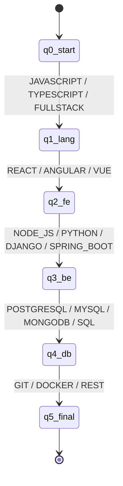
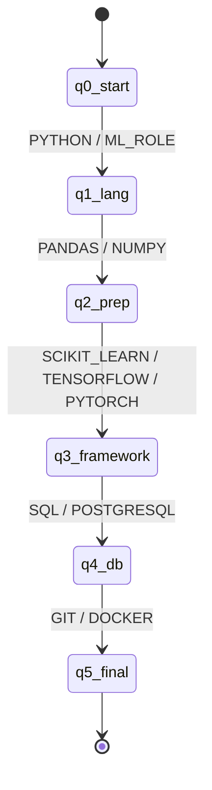
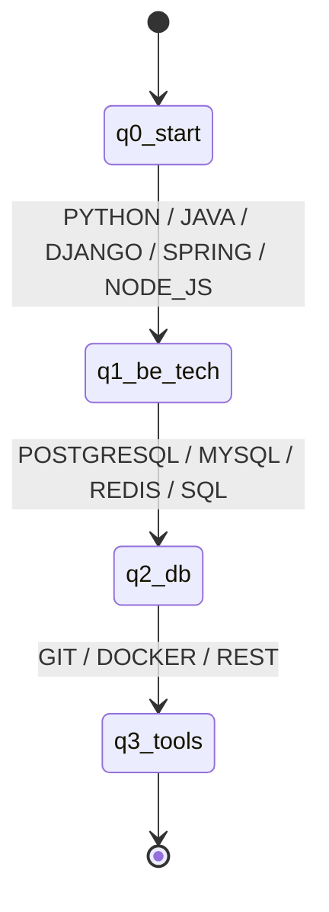
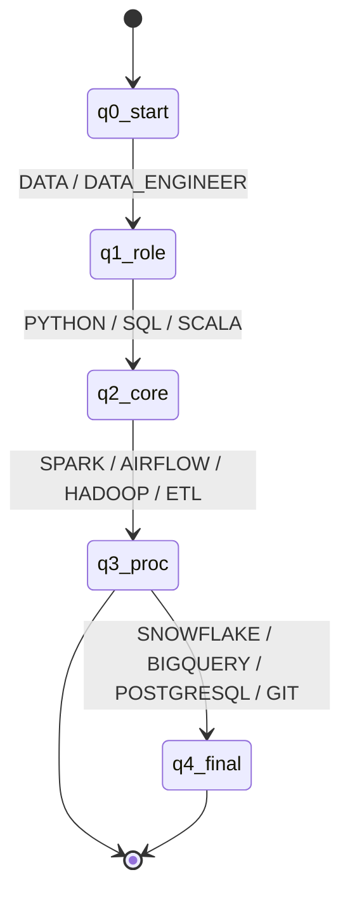

# Formal Specifications: Resume Profile Automata

Universidad Icesi  
Course: Discrete Structures III (CyED III, Código 09772)  
Integrative Project: ResumeLens  
Equipo: Nicolás Santiago Buelvas González, Daniel Alexander Nastul Flórez, Albert Valencia Escobar  
Profesor: Andrés Aristizábal (Grupo 3)

---

## 1. Formal Model and Conventions

Each profile recognizer is documented as a five-tuple:

$$M = (Q, \Sigma, \delta, q_0, F)$$

Where:
- $Q$: Finite set of named states tracking candidate progression across technology tiers.
- $\Sigma$: Input alphabet of recognized canonical skills and role tokens.
- $\delta$: Partial state transition function, $\delta: Q \times \Sigma \to Q$. An absent transition causes the automaton to reject the input string.
- $q_0 \in Q$: Unique start state.
- $F \subseteq Q$: Set of accepting final states.

All four automata implemented in ResumeLens are **Deterministic Finite Automata (DFA)**:
1. Determinism: For every state $q \in Q$ and input symbol $a \in \Sigma$, there exists at most one next state, $|\delta(q, a)| \le 1$.
2. Absence of $\varepsilon$-transitions: No transitions occur without consuming an input symbol.
3. Order-Preserving Categorical Hierarchy: Candidate qualifications are normalized and canonically sorted prior to recognition.

---

## 2. Full Stack Developer Automaton

$$M_{FS} = (Q_{FS}, \Sigma_{FS}, \delta_{FS}, q_{0,FS}, F_{FS})$$

- **States ($Q_{FS}$)**:
  $$Q_{FS} = \{ q0\_start, q1\_lang, q2\_fe, q3\_be, q4\_db, q5\_final \}$$
  - $q0\_start$: Initial state.
  - $q1\_lang$: Web role or foundational language verified (`JAVASCRIPT`, `TYPESCRIPT`, `FULLSTACK`, etc.).
  - $q2\_fe$: Frontend library/framework verified (`REACT`, `ANGULAR`, `VUE`, `HTML`, `CSS`, etc.).
  - $q3\_be$: Backend technology verified (`NODE_JS`, `DJANGO`, `SPRING_BOOT`, `FASTAPI`, `PYTHON`, etc.).
  - $q4\_db$: Database verified (`POSTGRESQL`, `MYSQL`, `MONGODB`, `REDIS`, `SQL`, etc.).
  - $q5\_final$: Version control and tooling verified (`GIT`, `DOCKER`, `REST_APIS`, etc.).
- **Start State**: $q_{0,FS} = q0\_start$
- **Accepting States**: $F_{FS} = \{ q5\_final \}$
- **Classification**: DFA (Deterministic Finite Automaton).

### Transition Function Highlights

| Source State | Category Group | Target State |
|:---|:---|:---:|
| `q0_start` / `q1_lang` | Roles / Web Languages (`JAVASCRIPT`, `TYPESCRIPT`, `FULLSTACK`) | `q1_lang` |
| `q1_lang` / `q2_fe` | Frontend UI Frameworks (`REACT`, `ANGULAR`, `VUE`, `HTML`, `CSS`) | `q2_fe` |
| `q2_fe` / `q3_be` | Backend Runtimes & Frameworks (`NODE_JS`, `DJANGO`, `SPRING_BOOT`, `PYTHON`) | `q3_be` |
| `q3_be` / `q4_db` | Relational / NoSQL Databases (`POSTGRESQL`, `MYSQL`, `MONGODB`, `SQL`) | `q4_db` |
| `q4_db` / `q5_final` | Tools & Version Control (`GIT`, `DOCKER`, `REST`, `GRAPHQL`) | `q5_final` |

### State Diagram

---

## 3. Machine Learning Engineer Automaton

$$M_{ML} = (Q_{ML}, \Sigma_{ML}, \delta_{ML}, q_{0,ML}, F_{ML})$$

- **States ($Q_{ML}$)**:
  $$Q_{ML} = \{ q0\_start, q1\_lang, q2\_prep, q3\_framework, q4\_db, q5\_final \}$$
  - $q0\_start$: Initial state.
  - $q1\_lang$: ML role or core language (`PYTHON`, `R`, `JULIA`, `MACHINE_LEARNING`, etc.).
  - $q2\_prep$: Tabular data processing package (`PANDAS`, `NUMPY`).
  - $q3\_framework$: ML / Deep Learning framework (`SCIKIT_LEARN`, `TENSORFLOW`, `PYTORCH`, `KERAS`).
  - $q4\_db$: Storage engine (`SQL`, `POSTGRESQL`, `MYSQL`, `MONGODB`).
  - $q5\_final$: Model tracking and DevOps tool (`GIT`, `DOCKER`, `AWS`, `GCP`).
- **Start State**: $q_{0,ML} = q0\_start$
- **Accepting States**: $F_{ML} = \{ q5\_final \}$
- **Classification**: DFA.

### Transition Function Highlights

| Source State | Category Group | Target State |
|:---|:---|:---:|
| `q0_start` / `q1_lang` | Core Language (`PYTHON`, `R`, `JULIA`) | `q1_lang` |
| `q1_lang` / `q2_prep` | Data Preparation (`PANDAS`, `NUMPY`) | `q2_prep` |
| `q2_prep` / `q3_framework` | ML Frameworks (`SCIKIT_LEARN`, `TENSORFLOW`, `PYTORCH`) | `q3_framework` |
| `q3_framework` / `q4_db` | Databases (`SQL`, `POSTGRESQL`, `MYSQL`) | `q4_db` |
| `q4_db` / `q5_final` | Tools & VCS (`GIT`, `DOCKER`) | `q5_final` |

### State Diagram

---

## 4. Backend Developer Automaton

$$M_{BE} = (Q_{BE}, \Sigma_{BE}, \delta_{BE}, q_{0,BE}, F_{BE})$$

- **States ($Q_{BE}$)**:
  $$Q_{BE} = \{ q0\_start, q1\_be\_tech, q2\_db, q3\_tools \}$$
  - $q0\_start$: Initial state.
  - $q1\_be\_tech$: Backend role, language, or service framework (`PYTHON`, `JAVA`, `GO`, `SPRING_BOOT`, `DJANGO`, `FASTAPI`, `NODE_JS`).
  - $q2\_db$: Persistence system (`POSTGRESQL`, `MYSQL`, `MONGODB`, `REDIS`, `SQL`).
  - $q3\_tools$: Tooling and infrastructure (`GIT`, `DOCKER`, `REST`, `GRAPHQL`, `AWS`).
- **Start State**: $q_{0,BE} = q0\_start$
- **Accepting States**: $F_{BE} = \{ q3\_tools \}$
- **Classification**: DFA.

### Transition Function Highlights

| Source State | Category Group | Target State |
|:---|:---|:---:|
| `q0_start` / `q1_be_tech` | Backend Languages & Frameworks (`PYTHON`, `JAVA`, `DJANGO`, `SPRING`, `NODE_JS`) | `q1_be_tech` |
| `q1_be_tech` / `q2_db` | Database Engines (`POSTGRESQL`, `MYSQL`, `REDIS`, `SQL`) | `q2_db` |
| `q2_db` / `q3_tools` | Tools & Version Control (`GIT`, `DOCKER`, `REST`, `API`) | `q3_tools` |

### State Diagram

---

## 5. Data Engineer Automaton

$$M_{DE} = (Q_{DE}, \Sigma_{DE}, \delta_{DE}, q_{0,DE}, F_{DE})$$

- **States ($Q_{DE}$)**:
  $$Q_{DE} = \{ q0\_start, q1\_role, q2\_core, q3\_proc, q4\_final \}$$
  - $q0\_start$: Initial state.
  - $q1\_role$: Data role identifier (`DATA`, `DATA_ENGINEER`, `DATA_PLATFORM_ENGINEER`).
  - $q2\_core$: Core pipeline programming / query language (`PYTHON`, `SQL`, `SCALA`, `JAVA`).
  - $q3\_proc$: Distributed processing engine / orchestrator (`SPARK`, `HADOOP`, `AIRFLOW`, `FLINK`, `ETL`).
  - $q4\_final$: Analytical warehouse and tools (`SQL`, `POSTGRESQL`, `SNOWFLAKE`, `BIGQUERY`, `GIT`, `DOCKER`).
- **Start State**: $q_{0,DE} = q0\_start$
- **Accepting States**: $F_{DE} = \{ q3\_proc, q4\_final \}$
- **Classification**: DFA.

### Transition Function Highlights

| Source State | Category Group | Target State |
|:---|:---|:---:|
| `q0_start` / `q1_role` | Roles (`DATA`, `DATA_ENGINEER`, `DATA_PLATFORM_ENGINEER`) | `q1_role` |
| `q0_start` / `q1_role` / `q2_core` | Core Languages (`PYTHON`, `SQL`, `SCALA`) | `q2_core` |
| `q0_start` / `q1_role` / `q2_core` / `q3_proc` | Processing Engines (`SPARK`, `HADOOP`, `AIRFLOW`, `ETL`) | `q3_proc` |
| `q3_proc` / `q4_final` | Warehouse & Tools (`SNOWFLAKE`, `BIGQUERY`, `POSTGRESQL`, `GIT`) | `q4_final` |

### State Diagram

---

## 6. Mathematical Summary Table

| Profile | $|Q|$ | Start State | Final States ($F$) | Type |
|:---|:---:|:---:|:---:|:---:|
| **Full Stack Developer** | 6 | `q0_start` | `{"q5_final"}` | DFA |
| **Machine Learning Engineer** | 6 | `q0_start` | `{"q5_final"}` | DFA |
| **Backend Developer** | 4 | `q0_start` | `{"q3_tools"}` | DFA |
| **Data Engineer** | 5 | `q0_start` | `{"q3_proc", "q4_final"}` | DFA |

---

## 7. Pipeline Integration and Verification

The automata are integrated directly into the screening pipeline through `src.pipeline.ResumeLensPipeline`:
- Candidate skills are extracted from raw plain-text curricula via `SkillExtractor` (Stage 1).
- Surface aliases are normalized into canonical alphabet tokens via `TransducerBuilder` (Stage 2).
- Normalized tokens are sorted hierarchically by profile category via `NormalizationPipeline.sort_for_profile()`.
- The sequence is converted to pyformlang `Symbol` instances and evaluated deterministically against `SoftwareAutomata` (`fullstack_dfa`, `backend_dfa`) and `DataAutomata` (`ml_dfa`, `data_dfa`).
- Verified acceptance vectors populate the candidate profile DSL model for syntax/semantic validation and report generation.
