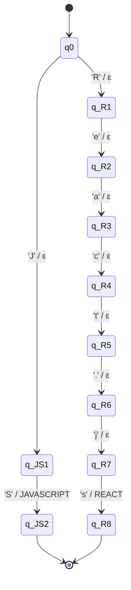
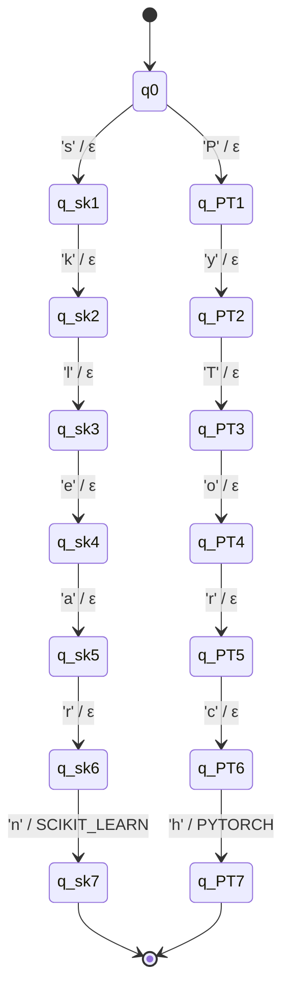

# Formal Mathematical Specifications: Extraction Regexes and Normalization Transducers

Universidad Icesi  
Curso: Estructuras Discretas III (CyED III)  
Proyecto Integrador: ResumeLens  
Autor: Nicolas Buelvas  

---

## 1. Stage 1: Regular Expression Extraction

### 1.1 Formal Definition of Candidate Languages

Let $\Sigma_{text}$ denote the standard ASCII/Unicode character set used in candidate résumés. A regular expression $R$ over $\Sigma_{text}$ defines a regular language $L(R) \subseteq \Sigma_{text}^*$.

#### 1.1.1 Contact Information Language
- **Email Language ($L_{email}$)**:
  $$R_{email} = [a-zA-Z0-9._%+-]+ @ [a-zA-Z0-9.-]+ \. [a-zA-Z]{2,}$$
  Recognizes standard RFC 5322 electronic mail identifiers.
- **Phone Language ($L_{phone}$)**:
  $$R_{phone} = (?:\+\d{1,3}\s*)?(?:\(?\d{3}\)?[\s.-]*)?\d{3}[\s.-]*\d{4}$$
  Recognizes international and Colombian standard telephone strings with arbitrary formatting characters.
- **LinkedIn / GitHub Profile Languages**:
  $$R_{linkedin} = (?:https?:\/\/)?(?:www\.)?linkedin\.com\/in\/([a-zA-Z0-9_-]+)$$
  $$R_{github} = (?:https?:\/\/)?(?:www\.)?github\.com\/([a-zA-Z0-9_-]+)$$

#### 1.1.2 Technical Skill Entity Language
For every canonical skill token $k \in K$, there exists a regular language $L_k$ recognizing its lexical surface variations within text boundaries:
$$R_k = \backslash b (v_1 \mid v_2 \mid \dots \mid v_m) \backslash b$$
where $v_i \in \text{Variations}(k)$. For example:
- $R_{JAVASCRIPT} = \backslash b (JavaScript \mid Javascript \mid JS) \backslash b$
- $R_{REACT} = \backslash b React(?:\.js \mid JS)? \backslash b$
- $R_{POSTGRESQL} = \backslash b Postgre(?:SQL \mid s) \backslash b$
- $R_{SCIKIT\_LEARN} = \backslash b (scikit[- ]learn \mid sklearn) \backslash b$

---

## 2. Stage 2: Finite-State Transducers (FST)

### 2.1 Formal 7-Tuple Model

In accordance with formal language theory and the course specifications, a Finite-State Transducer (FST) is defined as a 7-tuple:

$$M = (Q, \Sigma, \Gamma, \delta, \omega, q_0, F)$$

Where:
1. $Q$: A finite, non-empty set of states.
2. $\Sigma$: A finite input alphabet (character set consumed from candidate surface strings).
3. $\Gamma$: A finite output alphabet (canonical tokens emitted by the transducer).
4. $\delta$: The state transition function, $\delta: Q \times \Sigma \to Q$.
5. $\omega$: The output emission function, $\omega: Q \times \Sigma \to \Gamma^*$.
6. $q_0 \in Q$: The initial state.
7. $F \subseteq Q$: The set of final (accepting) states.

### 2.2 Transducer for Software Engineering Qualifications ($M_{SE}$)

The transducer $M_{SE} = (Q_{SE}, \Sigma_{SE}, \Gamma_{SE}, \delta_{SE}, \omega_{SE}, q_0, F_{SE})$ normalizes lexical variations of frontend, backend, database, and tool skills.

- **Input Alphabet ($\Sigma_{SE}$)**:
  $$\Sigma_{SE} = \{ \text{A-Z}, \text{a-z}, \text{0-9}, '.', '-', '\_', '\ ', '\#' \}$$
- **Output Alphabet ($\Gamma_{SE}$)**:
  $$\Gamma_{SE} = \{ \text{JAVASCRIPT}, \text{TYPESCRIPT}, \text{REACT}, \text{ANGULAR}, \text{VUE}, \text{NODE\_JS}, \text{DJANGO}, \text{SPRING\_BOOT}, \text{FASTAPI}, \text{EXPRESS}, \text{JAVA}, \text{GO}, \text{POSTGRESQL}, \text{MYSQL}, \text{MONGODB}, \text{REDIS}, \text{SQL}, \text{GIT}, \text{DOCKER}, \text{REST\_APIS}, \text{GRAPHQL} \}$$
- **States ($Q_{SE}$)**:
  $$Q_{SE} = \{ q_0 \} \cup \{ q_{w,i} \mid w \in \text{Domain}(M_{SE}), 1 \le i \le |w| \}$$
- **Transitions and Emissions ($\delta_{SE}, \omega_{SE}$)**:
  For each variant word $w = c_1 c_2 \dots c_n$ mapped to canonical symbol $K \in \Gamma_{SE}$:
  - $\delta(q_0, c_1) = q_{w,1}, \quad \omega(q_0, c_1) = \varepsilon$
  - $\delta(q_{w,i}, c_{i+1}) = q_{w,i+1}, \quad \omega(q_{w,i}, c_{i+1}) = \varepsilon \quad (\forall 1 \le i < n - 1)$
  - $\delta(q_{w,n-1}, c_n) = q_{w,n}, \quad \omega(q_{w,n-1}, c_n) = K$
  where $q_{w,n} \in F_{SE}$.

#### Transition Sub-table Example:
| Source State | Input Symbol ($c \in \Sigma$) | Target State | Output Symbol ($\omega \in \Gamma^*$) |
|:---|:---:|:---|:---:|
| $q_0$ | 'J' | $q_{JS,1}$ | $\varepsilon$ |
| $q_{JS,1}$ | 'S' | $q_{JS,2} \in F$ | `JAVASCRIPT` |
| $q_0$ | 'R' | $q_{React,1}$ | $\varepsilon$ |
| $q_{React,1}$ | 'e' | $q_{React,2}$ | $\varepsilon$ |
| $q_{React,2}$ | 'a' | $q_{React,3}$ | $\varepsilon$ |
| $q_{React,3}$ | 'c' | $q_{React,4}$ | $\varepsilon$ |
| $q_{React,4}$ | 't' | $q_{React,5}$ | $\varepsilon$ |
| $q_{React,5}$ | '.' | $q_{React,6}$ | $\varepsilon$ |
| $q_{React,6}$ | 'j' | $q_{React,7}$ | $\varepsilon$ |
| $q_{React,7}$ | 's' | $q_{React,8} \in F$ | `REACT` |

#### Graphical Representation (FST Subgraph Example - $M_{SE}$):

---

### 2.3 Transducer for AI & Data Science Qualifications ($M_{AI}$)

The transducer $M_{AI} = (Q_{AI}, \Sigma_{AI}, \Gamma_{AI}, \delta_{AI}, \omega_{AI}, q_0, F_{AI})$ normalizes programming languages, data processing packages, and machine learning frameworks.

- **Output Alphabet ($\Gamma_{AI}$)**:
  $$\Gamma_{AI} = \{ \text{PYTHON}, \text{SCALA}, \text{PANDAS}, \text{NUMPY}, \text{SCIKIT\_LEARN}, \text{TENSORFLOW}, \text{PYTORCH}, \text{SPARK}, \text{HADOOP}, \text{FLINK}, \text{AIRFLOW}, \text{SNOWFLAKE}, \text{BIGQUERY}, \text{SQL}, \text{POSTGRESQL}, \text{GIT}, \text{DOCKER} \}$$

#### Transition Sub-table Example:
| Source State | Input Symbol ($c \in \Sigma$) | Target State | Output Symbol ($\omega \in \Gamma^*$) |
|:---|:---:|:---|:---:|
| $q_0$ | 's' | $q_{sk,1}$ | $\varepsilon$ |
| $q_{sk,1}$ | 'k' | $q_{sk,2}$ | $\varepsilon$ |
| $q_{sk,2}$ | 'l' | $q_{sk,3}$ | $\varepsilon$ |
| $q_{sk,3}$ | 'e' | $q_{sk,4}$ | $\varepsilon$ |
| $q_{sk,4}$ | 'a' | $q_{sk,5}$ | $\varepsilon$ |
| $q_{sk,5}$ | 'r' | $q_{sk,6}$ | $\varepsilon$ |
| $q_{sk,6}$ | 'n' | $q_{sk,7} \in F$ | `SCIKIT_LEARN` |
| $q_0$ | 'P' | $q_{PT,1}$ | $\varepsilon$ |
| $q_{PT,1}$ | 'y' | $q_{PT,2}$ | $\varepsilon$ |
| $q_{PT,2}$ | 'T' | $q_{PT,3}$ | $\varepsilon$ |
| $q_{PT,3}$ | 'o' | $q_{PT,4}$ | $\varepsilon$ |
| $q_{PT,4}$ | 'r' | $q_{PT,5}$ | $\varepsilon$ |
| $q_{PT,5}$ | 'c' | $q_{PT,6}$ | $\varepsilon$ |
| $q_{PT,6}$ | 'h' | $q_{PT,7} \in F$ | `PYTORCH` |

#### Graphical Representation (FST Subgraph Example - $M_{AI}$):

---

## 3. Canonical Ordering Algorithm

Before passing normalized qualification symbols to Stage 3 finite automata, the set of symbols is ordered deterministically according to the canonical hierarchy of the profile $P$:

$$\text{Sort}(S, P) = \text{order by } (\text{Priority}(\text{Category}(s, P)), s) \quad \forall s \in (S \cap \Sigma_P)$$

This transformation ensures invariant classification regardless of the textual order in the raw curriculum:
$$\text{FST}(\text{"Git, NodeJS, JS, Postgres, React.js"}) \xrightarrow{\text{CanonicalSort}} (\text{JAVASCRIPT}, \text{REACT}, \text{NODE\_JS}, \text{POSTGRESQL}, \text{GIT})$$
